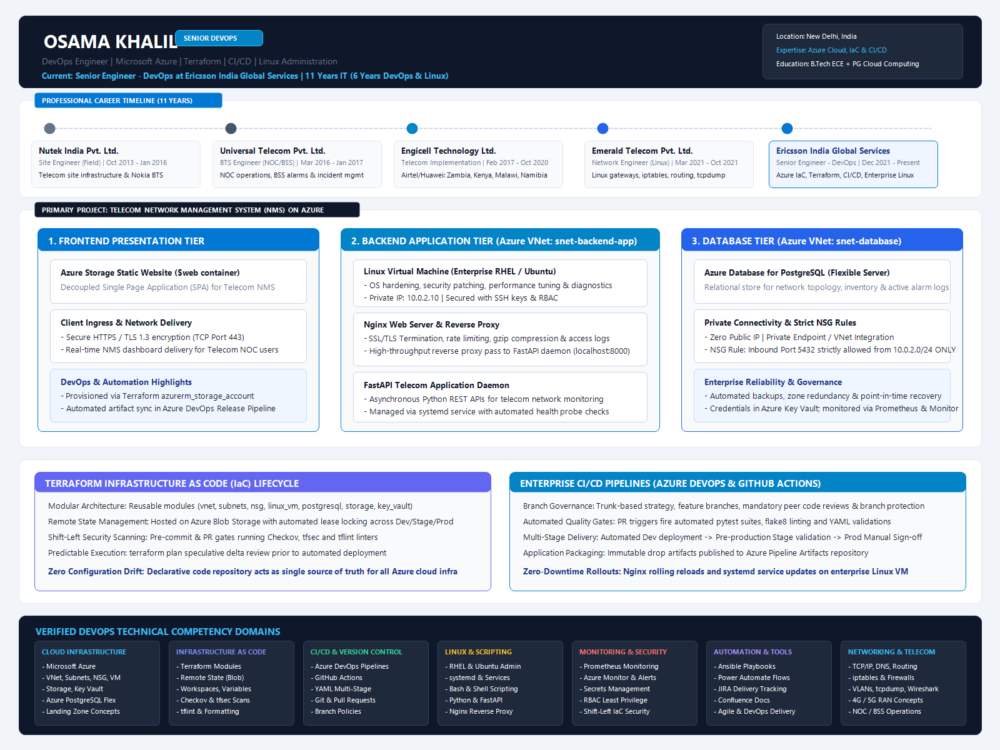
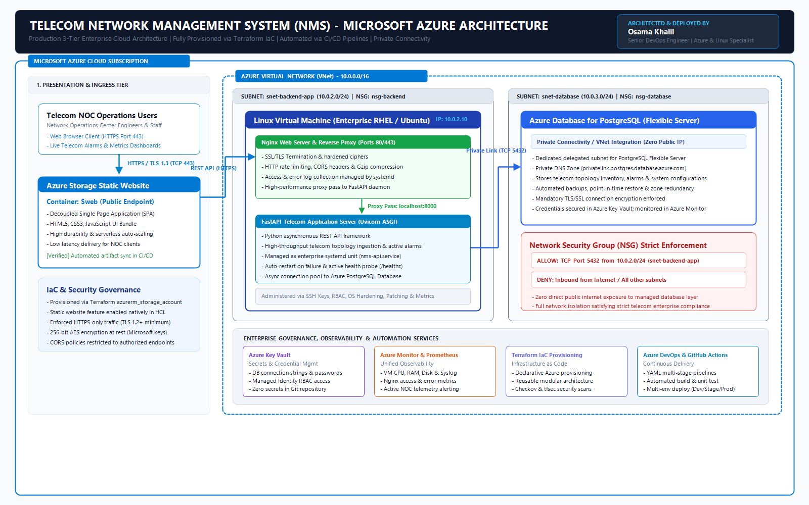
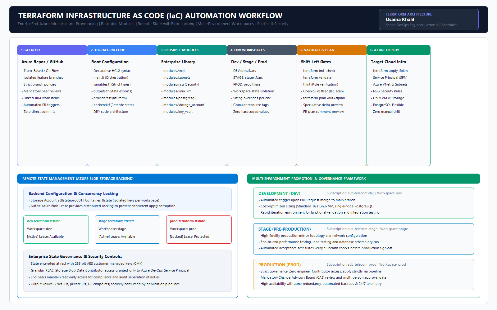
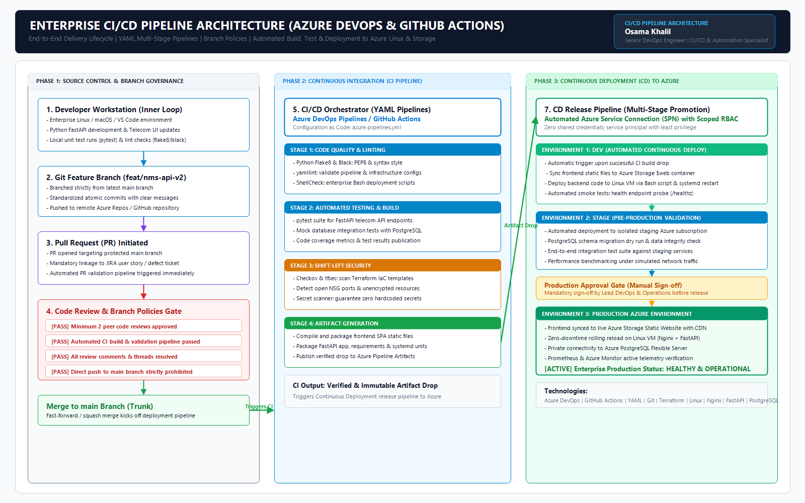

# Osama Khalil | Senior DevOps Engineer & Cloud Architect

<div align="center">

[](https://azure.microsoft.com/)
[](https://www.terraform.io/)
[](https://azure.microsoft.com/en-us/products/devops)
[](https://github.com/features/actions)
[](https://www.kernel.org/)
[](https://www.postgresql.org/)
[](https://khalilosam.github.io/)

**Senior Engineer – DevOps @ Ericsson India Global Services**  
*11 Years Total IT Experience | 6 Years DevOps & Enterprise Linux | Telecom & Networking Foundation*

📍 New Delhi, India &nbsp;|&nbsp; ✉️ [khalil.osama91@gmail.com](mailto:khalil.osama91@gmail.com) &nbsp;|&nbsp; 📞 +91-9430088343 &nbsp;|&nbsp; 💼 [GitHub Profile](https://github.com/khalilosam)

</div>

---

## 🎯 Executive Summary

Senior DevOps Engineer with **11 years of total IT industry experience**, including **6 years specializing in DevOps engineering, cloud architecture automation, and enterprise Linux administration**, built upon a robust telecom and core networking foundation.

- **Cloud & Automation Specialist:** Expert in architecting, provisioning, and managing enterprise cloud infrastructure on **Microsoft Azure** using **Terraform (Infrastructure as Code)** with reusable modules (`for_each`, complex `map` data structures, and `dynamic` blocks), remote state locking, and multi-environment workspace management across Dev, Stage, and Production.
- **Continuous Delivery & Git Governance:** Proven track record designing and maintaining enterprise CI/CD workflows using **Azure DevOps Pipelines** and **GitHub Actions**, enforcing trunk-based branching, pull request policies, and automated shift-left security checks (**Checkov**, **tfsec**, **tflint**, **Bandit SAST**).
- **Enterprise Linux Administration:** Deep hands-on proficiency in **RHEL** and **Ubuntu**, including performance tuning, OS patching, systemd service management, reverse proxies (**Nginx**), and shell automation (**Bash**).
- **Telecom & Networking Roots:** Comprehensive Layer 2–4 networking knowledge (**TCP/IP, DNS, VLANs, 802.3ad LACP bonding, iptables, tcpdump, Wireshark**) combined with hands-on 4G/5G cellular site commissioning and NOC/BSS operations across Africa (Kenya, Zambia, Malawi, Namibia).

---

## 📦 Featured Open-Source Engineering Repositories

Explore my production-ready codebases and architecture implementations:

| Repository | Focus & Technologies | Key Capabilities | Link |
| :--- | :--- | :--- | :--- |
| **`terraform-azure-enterprise-modules`** | Azure, Terraform 1.7+, IaC, Checkov | Production-ready child modules built with `for_each`, `map(object)`, and `dynamic` blocks. Complete 3-tier NMS reference deployment (VNet, Subnets, NSG, Linux VM, PostgreSQL Flexible Server, Storage Static Website, Key Vault). | [📂 Explore Code](https://github.com/khalilosam/terraform-azure-enterprise-modules) |
| **`telecom-nms-azure-platform`** | FastAPI, PostgreSQL, Nginx, Linux, Python | Enterprise Telecom NOC & Fault Management Platform. Ingests live RAN alarms (VSWR degradation, AC mains loss, CPRI link faults), cell site inventory across regional hubs, dark-mode NOC dashboard, and systemd daemon. | [📂 Explore Code](https://github.com/khalilosam/telecom-nms-azure-platform) |
| **`azure-devops-cicd-pipelines`** | Azure DevOps, GitHub Actions, YAML, SAST | Multi-stage YAML pipelines with Flake8 linting, Bandit SAST security scans, Pytest with Cobertura coverage, Checkov IaC security gates, multi-environment deployment (`Dev` → `Stage` → `Prod`), and automated rollbacks. | [📂 Explore Code](https://github.com/khalilosam/azure-devops-cicd-pipelines) |
| **`linux-telecom-automation-scripts`** | RHEL, Ubuntu, Bash, Python, Prometheus | Carrier-grade Linux administration toolkit: 3GPP packet captures (GTP-U, Diameter, SIP, S1-AP), 802.3ad LACP network bonding, iptables security hardening, SNMP trap receiver daemon, and Prometheus RAN KPI exporter. | [📂 Explore Code](https://github.com/khalilosam/linux-telecom-automation-scripts) |

---

## 🚀 Professional Architecture & Engineering Workflow

This section highlights the technical portfolio, real-world cloud architectures, and automation pipelines designed and maintained in production.

---

### 1. Technical Portfolio Overview & Career Architecture

Comprehensive architecture board detailing my career progression, core technical domains, and the primary telecom cloud project structure.

<div align="center">
  
</div>

<p align="center">
  <b>Formats available:</b>
  <a href="assets/diagrams/01-professional-profile.pdf">📄 High-Resolution Vector PDF</a> &nbsp;|&nbsp;
  <a href="assets/diagrams/01-professional-profile.svg">🎨 Vector SVG</a> &nbsp;|&nbsp;
  <a href="assets/diagrams/01-professional-profile.png">🖼️ PNG Image</a>
</p>

---

### 2. Main Project Architecture: Telecom Network Management System (NMS) on Microsoft Azure

A resilient, highly secure 3-tier cloud architecture designed to collect, process, and display telecom network alarms and topology metrics for 24/7 Network Operations Center (NOC) engineers.

🔗 **Live Code Repository:** [`khalilosam/telecom-nms-azure-platform`](https://github.com/khalilosam/telecom-nms-azure-platform)

<div align="center">
  
</div>

<p align="center">
  <b>Formats available:</b>
  <a href="assets/diagrams/02-azure-nms-architecture.drawio">📐 Editable Draw.io / Diagrams.net File</a> &nbsp;|&nbsp;
  <a href="assets/diagrams/02-azure-nms-architecture.pdf">📄 High-Resolution Vector PDF</a> &nbsp;|&nbsp;
  <a href="assets/diagrams/02-azure-nms-architecture.svg">🎨 Vector SVG</a> &nbsp;|&nbsp;
  <a href="assets/diagrams/02-azure-nms-architecture.png">🖼️ PNG Image</a>
</p>

#### Architecture Layer Breakdown:

* **Presentation Layer (Frontend):**
  * Hosted on **Azure Storage Static Website** in the `$web` blob container.
  * Serves a Single Page Application (SPA) NOC dashboard directly over HTTPS (Port 443) with TLS 1.3 encryption.
  * Serverless, auto-scaling, and completely decoupled from the backend application runtime.
* **Backend Application Tier:**
  * Provisioned inside an isolated Azure Virtual Network (`10.0.0.0/16`) within the `snet-backend-app` (`10.0.2.0/24`) subnet.
  * Runs on an enterprise **Linux Virtual Machine** (RHEL / Ubuntu LTS) with private IP `10.0.2.10`.
  * **Nginx Web Server & Reverse Proxy:** Handles SSL/TLS termination, HTTP security headers, rate limiting, and reverse proxies inbound API calls to `localhost:8000`.
  * **FastAPI Application Server:** High-throughput Python ASGI daemon managed as a systemd service (`nms-api.service`) with auto-restart, active health checks (`/healthz`), and async connection pools.
* **Database Layer:**
  * Managed **Azure Database for PostgreSQL (Flexible Server)** running inside `snet-database` (`10.0.3.0/24`).
  * **Zero Public IP exposure:** Accessible strictly via **Private Connectivity / VNet Integration** and Private DNS Zone (`privatelink.postgres.database.azure.com`).
  * **Network Security Group (NSG) Rule:** Inbound Port 5432 is strictly restricted to traffic originating from `snet-backend-app` (`10.0.2.0/24`), with default deny-all from the internet.
* **Cross-Cutting Governance & Observability:**
  * **Azure Key Vault:** Centralized secrets management for database passwords, API credentials, and certificates; zero credentials stored in code.
  * **Azure Monitor & Prometheus:** Host CPU, memory, disk, and Nginx metrics monitoring with automated alerting rules for NOC engineers.

---

### 3. Terraform Infrastructure as Code (IaC) Automation Workflow

Fully automated infrastructure provisioning pipeline enforcing modular development, remote state locking on Azure Storage, and shift-left security checks.

🔗 **Live Code Repository:** [`khalilosam/terraform-azure-enterprise-modules`](https://github.com/khalilosam/terraform-azure-enterprise-modules)

<div align="center">
  
</div>

<p align="center">
  <b>Formats available:</b>
  <a href="assets/diagrams/03-terraform-workflow.drawio">📐 Editable Draw.io / Diagrams.net File</a> &nbsp;|&nbsp;
  <a href="assets/diagrams/03-terraform-workflow.pdf">📄 High-Resolution Vector PDF</a> &nbsp;|&nbsp;
  <a href="assets/diagrams/03-terraform-workflow.svg">🎨 Vector SVG</a> &nbsp;|&nbsp;
  <a href="assets/diagrams/03-terraform-workflow.png">🖼️ PNG Image</a>
</p>

#### Key Terraform Engineering Capabilities:
* **Advanced HCL Constructs:** Production modules utilizing `for_each` over maps, dynamic blocks (`dynamic "security_rule"`, `dynamic "access_policy"`), and input validation blocks.
* **Reusable Child Modules:** Standardized modules for `vnet`, `subnets`, `nsg`, `linux_vm`, `postgresql_flexible`, `storage_account`, and `key_vault`.
* **Remote State Management:** Centralized state hosted in Azure Blob Storage (`sttfstateprod01/tfstate`) with automated blob lease-based distributed locking to prevent concurrency collisions.
* **Workspace Isolation:** Clean environment separation using Terraform workspaces (`dev`, `stage`, `prod`) paired with environment-specific `.tfvars`.
* **Shift-Left Security Gate:** Automated CI validation using `terraform fmt -check`, `terraform validate`, `tflint`, and security policy scanners (`Checkov`, `tfsec`) prior to generating `terraform plan`.
* **Multi-Environment Promotion:** Controlled deployment via Azure DevOps Service Connections from development to staging to production approval gates.

---

### 4. Enterprise CI/CD Pipeline Architecture

End-to-end continuous integration and deployment flow implemented using **Azure DevOps Pipelines** and **GitHub Actions** with YAML configurations.

🔗 **Live Code Repository:** [`khalilosam/azure-devops-cicd-pipelines`](https://github.com/khalilosam/azure-devops-cicd-pipelines)

<div align="center">
  
</div>

<p align="center">
  <b>Formats available:</b>
  <a href="assets/diagrams/04-cicd-pipeline.drawio">📐 Editable Draw.io / Diagrams.net File</a> &nbsp;|&nbsp;
  <a href="assets/diagrams/04-cicd-pipeline.pdf">📄 High-Resolution Vector PDF</a> &nbsp;|&nbsp;
  <a href="assets/diagrams/04-cicd-pipeline.svg">🎨 Vector SVG</a> &nbsp;|&nbsp;
  <a href="assets/diagrams/04-cicd-pipeline.png">🖼️ PNG Image</a>
</p>

#### Pipeline Execution Stages:
1. **Developer Inner Loop:** Feature branches (`feat/*`) branched from `main`, tested locally with `pytest` and formatted with `flake8`/`black`.
2. **Branch Protection & Code Reviews:** Enforced pull request policies requiring peer reviews, green CI checks, and linked JIRA tickets before merge.
3. **CI Build & Validation:** Multi-stage YAML pipeline executing static analysis, automated unit tests, and Checkov IaC security scanning.
4. **Artifact Drop:** Generation of immutable drop packages published to Azure Pipeline Artifacts.
5. **CD Release Stages:**
   * **DEV:** Automated deployment and smoke testing.
   * **STAGE:** Production mirror deployment, database migration dry-run, and integration test suite.
   * **PROD:** Mandatory Change Advisory Board (CAB) sign-off, canary health probes, and automated rollback upon failure.

---

## 💼 Professional Experience Timeline

| Timeline | Company | Role | Core Contributions |
| :--- | :--- | :--- | :--- |
| **Dec 2021 – Present** | **Ericsson India Global Services Pvt. Ltd.** | Senior Engineer – DevOps | Designed and maintained Azure cloud infrastructure using Terraform modules; automated multi-stage CI/CD pipelines in Azure DevOps & GitHub Actions; enterprise Linux server administration (RHEL/Ubuntu); implemented shift-left security (Checkov, tfsec); Bash & Power Automate automation. |
| **Mar 2021 – Oct 2021** | **Emerald Telecom Pvt. Ltd.** | Network Engineer (Linux) – Project | Administered Linux-based network servers and gateways; managed IP routing, iptables firewall rules, and interface bonding; performed deep-packet diagnostics with tcpdump and Wireshark. |
| **Feb 2017 – Oct 2020** | **Engicell Technology Ltd.** | Telecom Implementation Engineer | Multi-country network rollout across Zambia, Kenya, Malawi, and Namibia on Huawei & Airtel platforms; commissioning, integration, testing, and telecom site turn-up. |
| **Mar 2016 – Jan 2017** | **Universal Telecom Pvt. Ltd.** | BTS Engineer (NOC / BSS) | 24/7 NOC monitoring, alarm correlation, incident resolution, and Base Station Subsystem (BSS) first-level troubleshooting. |
| **Oct 2013 – Jan 2016** | **Nutek India Pvt. Ltd.** | Site Engineer (Field) | Telecom field installation, microwave and Nokia BTS integration (ODU/IDU, FIU, FXC RRI, Ultra Site BTS), VSWR testing, and SAT commissioning procedures. |

---

## 🛠️ Technical Skills & Competencies

```
CLOUD PLATFORMS:
└── Microsoft Azure (VNet, Subnets, NSG, VMs, Blob Storage, Key Vault, Azure Monitor, PostgreSQL Flexible, Landing Zone concepts)

INFRASTRUCTURE AS CODE (IaC):
└── Terraform (Child Modules, for_each, Maps, Dynamic Blocks, Remote State in Azure Storage, Workspaces, tflint, Checkov, tfsec)

CI/CD & VERSION CONTROL:
└── Azure DevOps Pipelines, GitHub Actions, YAML Pipelines, Git, Branch Protection Policies, Pull Request Workflows

LINUX & SYSTEM ADMINISTRATION:
└── Red Hat Enterprise Linux (RHEL), Ubuntu, systemd Services, SSH, Bash Scripting, Python, Nginx Reverse Proxy

NETWORKING & TELECOM:
└── TCP/IP, DNS, Routing, VLANs, 802.3ad LACP Bonding, iptables Firewalls, tcpdump, Wireshark, 4G/5G RAN, NOC/BSS Operations

SECURITY & OBSERVABILITY:
└── Prometheus, Azure Monitor & Log Analytics, RBAC Least Privilege, Secrets Management, Shift-Left IaC Scanning

AUTOMATION & COLLABORATION:
└── Ansible Playbooks, Power Automate Flows, JIRA, Confluence, Agile/Scrum Methodologies
```

---

## 🎓 Education & Certifications

* **Master of Business Administration (MBA) — Project Planning & Project Management**  
  *Jamia Hamdard* | Jun 2025 – Jul 2027
* **Post Graduate Program in Cloud Computing**  
  *Great Lakes Executive Learning, New Delhi* | October 2024
* **Bachelor of Technology (B. Tech) — Electronics & Communication Engineering**  
  *Maharishi Dayanand University, Faridabad* | 2008 – 2012

---

## 📬 Connect With Me

* **Email:** [khalil.osama91@gmail.com](mailto:khalil.osama91@gmail.com)
* **Phone:** +91-9430088343
* **Location:** New Delhi, India
* **GitHub:** [github.com/khalilosam](https://github.com/khalilosam)

---

<div align="center">
  <sub>Architected with precision. Engineered for cloud reliability.</sub>
</div>
